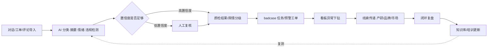

# 001 · 产品需求文档（PRD）

| 项 | 内容 |
|---|---|
| 项目 | AI 客服运营质量管控工作台 MVP（QCC Workbench） |
| 版本 | v0.1.0 |
| 作者 | 产品 / Lead |
| 日期 | 2026-11-03 |
| 状态 | MVP 设计（Gate 0 通过后冻结基线） |
| 上游 | 用户提供的项目 PRD 原始需求（2026-11-03） |
| 下游 | `002-spec.md`（功能规格）、`007-evaluation-spec.md`（指标口径） |

> 说明：本 PRD 保留原始需求的事实与范围，只做结构化、编号化与验收口径补全；实现细节不写入 PRD。

## 1. 背景与问题

见 `000-charter.md` §2。核心问题一句话：**质量发现是抽样且断链的，舆情响应是人工且滞后的，指标与行动之间没有通路。**

## 2. 目标与成功指标

业务目标：

1. 提升质检覆盖率与 badcase 闭环率。
2. 缩短舆情响应时长，降低重复舆情。
3. 提升线索转化：客服/舆情发现的问题能进入产研、品牌、市场。

成功指标（MVP 验收目标）见 `000-charter.md` §4 与 `007-evaluation-spec.md`。PRD 只保留一句验收口径：**每个指标都能在 Demo 中用评测集或种子数据算出来并展示，而不是写在 PPT 上。**

## 3. 用户角色与场景

| 角色 | 核心目标 | 痛点 | 关键场景 | 对应需求 |
|---|---|---|---|---|
| 坐席 / 一线 | 知道哪里做错了并改正 | 质检结果不透明、不知道标准 | 收到复核结果、接收改进任务、查看个人质检分 | PRD-QC-04、PRD-QC-05 |
| 质检 / 培训 | 提升抽检效率与标准一致性 | 抽检覆盖率低、标准不一 | 复核低置信度样本、badcase 归因、发起培训任务 | PRD-QC-02、PRD-QC-03、PRD-QC-04 |
| 客服主管 | 掌握质量与风险全局 | 指标散、异常追不到人 | 看板看趋势、异常下钻、SLA 催办 | PRD-SYS-01、PRD-QC-03 |
| 品牌 / 市场 | 第一时间知道舆情并响应 | 舆情发现晚、口径不统一 | 接收 P0/P1 预警、执行 SOP、生成对外口径 | PRD-SEN-03、PRD-SEN-04 |
| 产研 | 拿到可行动的产品问题 | 客服反馈零散、缺证据 | 接收产品问题线索、反馈处理结果 | PRD-SYS-02 |
| 算法 / 研发 | 知道模型边界与错例 | 只有指标没有错例 | 低置信度复核、评测集、错例分析 | PRD-QC-02、PRD-NFR-03 |

## 4. 整体流程

## 5. 模块一：AI 质检与 badcase 闭环

### 5.1 质检规则与标签体系

| 需求 ID | 需求 | 优先级 |
|---|---|---|
| PRD-QC-01 | 建立 6 类质检标签：服务态度、违规话术、答非所问、知识错误、响应超时、情绪升级；每类有可判定的定义与严重级别。 | P0 |
| PRD-QC-02 | 标签命中必须附证据（原文片段 + 位置），允许质检员认可或改判。 | P0 |

### 5.2 AI 检测流程

| 需求 ID | 需求 | 优先级 |
|---|---|---|
| PRD-QC-03 | 对话导入后自动完成分类、摘要、情绪识别、违规检测与评分，全量覆盖。 | P0 |
| PRD-QC-04 | 低置信度（< 0.75）自动转人工复核；人工复核结果作为准确率基线。 | P0 |
| PRD-QC-05 | 支持筛查与排序：按结论、标签、渠道、复核状态、分数、时间检索。 | P1 |

### 5.3 badcase 归因与任务分派

| 需求 ID | 需求 | 优先级 |
|---|---|---|
| PRD-QC-06 | 复核确认的问题可一键转为 badcase，归因到知识缺失 / 话术问题 / 流程问题 / 系统问题。 | P0 |
| PRD-QC-07 | badcase 必须指定责任人、SLA 时限，并支持 开放→处理中→待验证→已闭环 状态流转与超时提醒。 | P0 |
| PRD-QC-08 | 闭环必须提交"闭环证明"（知识库更新/培训/流程变更），否则不可关闭。 | P1 |
| PRD-QC-09 | 支持标记复发：同一根因 + 同一标签的闭环后重复出现。 | P1 |

### 5.4 培训与知识库联动

| 需求 ID | 需求 | 优先级 |
|---|---|---|
| PRD-QC-10 | 高频 badcase 可沉淀为培训任务或知识库更新项，并记录复测结果。 | P2（MVP 以闭环证明中的动作类型体现） |

### 5.5 验收标准

| 需求 ID | 需求 | 优先级 |
|---|---|---|
| PRD-QC-11 | 质检覆盖率 ≥ 90%，准确率 ≥ 80%，误报率 ≤ 15%，复核占比 ≤ 30%（口径见 MET）。 | P0 |
| PRD-QC-12 | badcase 闭环率 ≥ 70%，同类问题复发率有基线且可下降。 | P0 |

### 5.6 风险与边界

- 隐私脱敏：导入对话先脱敏（手机号/订单号/身份证），评测集全部为合成数据。
- AI 不直接处罚：AI 结论仅用于质检与改进，处罚动作必须人工确认。
- 人工复核保留：任何自动结论都可被复核改判，并留痕。
- 模型误判申诉：质检结果支持"申诉"记录（MVP 以复核备注体现）。

## 6. 模块二：舆情分级预警与快速响应

### 6.1 数据源与采集

| 需求 ID | 需求 | 优先级 |
|---|---|---|
| PRD-SEN-01 | 支持 Steam / TapTap / GooglePlay / 社群 / 客服工单 五类来源的评论导入；MVP 用公开评论 + 导入数据。 | P0 |

### 6.2 情感分类与主题聚类

| 需求 ID | 需求 | 优先级 |
|---|---|---|
| PRD-SEN-02 | 对评论做情感分类（正/中/负）与主题归类（版本、充值、外挂、客服、活动、Bug、其他）。 | P0 |

### 6.3 分级规则

| 需求 ID | 需求 | 优先级 |
|---|---|---|
| PRD-SEN-03 | 按 P0（大规模负面/媒体风险）、P1（集中负面/上升趋势）、P2（一般反馈）分级；各级有触发条件、责任人、时限。 | P0 |
| PRD-SEN-04 | 同主题当日负面达到阈值时自动升级（聚合升级规则）。 | P1 |

### 6.4 响应 SOP 与工单

| 需求 ID | 需求 | 优先级 |
|---|---|---|
| PRD-SEN-05 | 预警生成后进入 确认→响应→（升级）→解决 的 SOP 流程，记录首次响应、处理动作与时间戳。 | P0 |
| PRD-SEN-06 | 支持从预警一键生成对外口径草稿与跨团队线索（品牌/市场/产研）。 | P1 |

### 6.5 看板与复盘

| 需求 ID | 需求 | 优先级 |
|---|---|---|
| PRD-SEN-07 | 展示舆情趋势、来源分布、主题分布、响应时长、升级率、重复舆情。 | P1 |

### 6.6 验收标准

| 需求 ID | 需求 | 优先级 |
|---|---|---|
| PRD-SEN-08 | 预警准确率 ≥ 80%；P0 响应 ≤ 30 分钟；P1 响应 ≤ 2 小时；主题准确率 ≥ 75%；情感准确率 ≥ 80%。 | P0 |

### 6.7 风险与边界

- 不自动对外发布：SOP 中的"对外口径"只能是草稿，由品牌/市场确认。
- 不替代公关判断：P0 升级必须由人确认，系统只提供事实与建议。
- 低置信度人工确认：舆情判定置信度 < 0.75 时进入人工确认队列。

## 7. 模块三：运营看板与线索传递（底座）

| 需求 ID | 需求 | 优先级 |
|---|---|---|
| PRD-SYS-01 | 统一指标：解决率、转人工率、首响、满意度、质检得分、舆情趋势、成本；支持时间范围切换与趋势对比。 | P0 |
| PRD-SYS-02 | 异常下钻：指标异常 → case 列表 → 责任人 → 改进任务/线索，下钻链路可返回。 | P0 |
| PRD-SYS-03 | 一键生成线索：从质检 case / 舆情预警 / 看板异常生成"产品问题/商机线索"给产研/品牌/市场，记录状态与闭环。 | P0 |
| PRD-SYS-04 | 线索看板：状态分布、目标团队分布、闭环率与转化率。 | P1 |

## 8. 非功能需求

| 需求 ID | 需求 | 优先级 |
|---|---|---|
| PRD-NFR-01 | 隐私脱敏：手机号/订单号/身份证/邮箱导入时脱敏；界面不展示完整敏感信息。 | P0 |
| PRD-NFR-02 | 可追溯：所有人工与系统状态变更写时间线（谁、何时、动作、前后状态）。 | P0 |
| PRD-NFR-03 | 成本控制：规则引擎本地运行，无外部 API 调用；评测可离线重复执行。 | P1 |
| PRD-NFR-04 | 性能：种子规模（≤ 500 对话 / ≤ 1000 评论）下列表接口 P95 < 300ms，页面首屏 < 2s。 | P1 |
| PRD-NFR-05 | 可用性：一键重置演示数据；核心页面有加载/空/错误态。 | P1 |
| PRD-NFR-06 | 评测集版本管理：数据集带版本号，标签变更可追溯。 | P0 |
| PRD-NFR-07 | 无外部服务依赖，`pnpm install && pnpm dev` 可在本地离线演示。 | P0 |

## 9. MVP 范围与不做什么

**做：**

- AI 质检 + 标签证据 + 低置信度复核；
- badcase 归因/分派/SLA/状态流转/闭环证明；
- 舆情评论分析 + P0/P1/P2 预警 + SOP 工单 + 响应计时；
- 运营看板（趋势 + 异常下钻）；
- 线索传递与闭环；
- 评测中心（质检与舆情评测集、指标、混淆矩阵、错例）；
- 一键重置的演示数据与 6 条演示脚本。

**不做：**

- 完整客服系统、真实工单系统对接；
- 自动处罚、自动对外发布；
- 全渠道爬虫、真实 LLM 训练/微调；
- 多租户、计费、真实鉴权、生产级数据库。

## 10. 里程碑

| 阶段 | 周期 | 产出 | 退出条件 |
|---|---|---|---|
| M0 需求与规格 | 第 1-2 周 | 章程/PRD/spec/评测口径 | Gate 0-2 通过 |
| M1 技术方案 | 第 2-3 周 | 架构/数据模型/API/UI 规格 | Gate 3 通过 |
| M2 Demo 开发 | 第 3-6 周 | 可运行 MVP（本次推进的最小可演示版） | 主链路可演示 |
| M3 试用 | 第 7-8 周 | 试用反馈、badcase 修复 | 试用记录 |
| M4 复盘与作品集 | 第 9-10 周 | 评测报告、复盘、演示材料 | Gate 6 通过 |

> 本次交付（2026-11-03）目标：完成 M0/M1 全部文档，并把 M2 推进到**可运行、可演示、可评测**的状态。

## 11. 风险与应对

| # | 风险 | 应对 |
|---|---|---|
| 1 | 数据不足 | 公开评论 + 合成脱敏对话 + 数据生成脚本，明确标注合成 |
| 2 | 准确率不稳 | 低置信度人工复核 + 规则兜底 + 每周评测复测 |
| 3 | 试用没人 | 前同事 / 中小团队 / 内部模拟评审 |
| 4 | 时间不够 | 先质检后舆情，P2 全部后置 |
| 5 | 演示环境不稳定 | 一键重置 + 离线运行 + 演示脚本 |

## 12. 附录（交付物索引）

| 附录 | 文件 |
|---|---|
| 指标口径表 | `docs/metric-dictionary.md`、`007-evaluation-spec.md` |
| 评测集说明 | `data/README.md`、`007-evaluation-spec.md` |
| badcase 模板 | `docs/badcase-template.md` |
| 舆情分级 SOP | `docs/sentiment-sop.md` |
| 线索模板 | `docs/clue-template.md` |
| 演示脚本 | `docs/demo-script.md` |

## 13. 变更记录

| 版本 | 日期 | 变更 | 作者 |
|---|---|---|---|
| v0.1.0 | 2026-11-03 | 初版：基于用户 PRD 结构化、编号化、补验收口径 | Lead |
