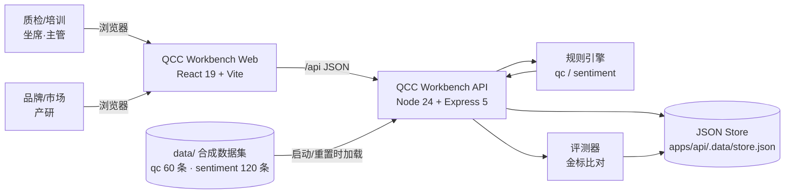
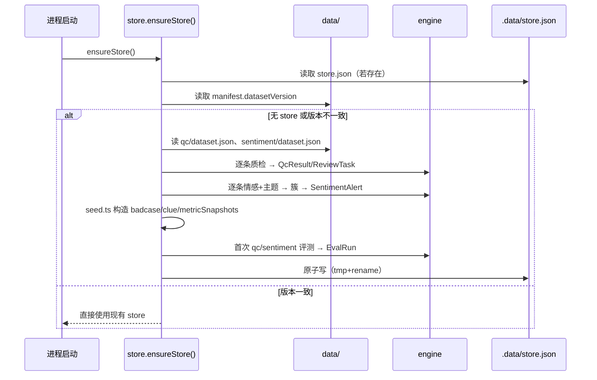
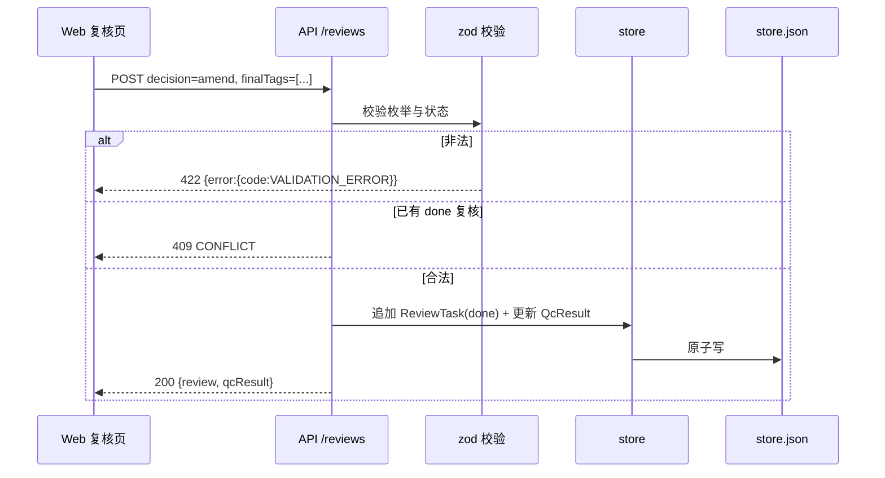
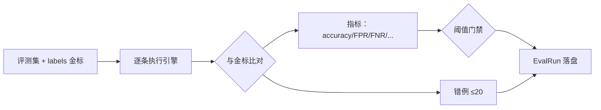

# SDD-003 技术架构设计

> 版本：v0.1.0 ｜ 状态：已冻结（Baseline） ｜ 更新：2026-11-03
> 上游：`002-spec.md`、`004-data-model.md`、`005-api-contract.md` ｜ 下游：`008-tasks.md`、`tests/`

---

## 1. 架构目标

| 目标 | 说明 | 验收 |
|---|---|---|
| 可演示 | 一条命令启动，浏览器内完成「检测 → 复核 → 派单 → 预警 → 线索 → 看板 → 评测」全流程 | 演示脚本 10 分钟内跑通 |
| 契约优先 | OpenAPI 是前后端唯一事实来源，字段不口头约定 | 前端无硬编码枚举，字段与契约一致 |
| 确定性 | 同一数据集 + 同一引擎版本 → 相同结果 | 连续两次 reset 后结果一致 |
| 零成本 | 不使用真实 LLM/外部 API/爬虫，离线可跑 | 断网启动成功，成本面板 0 元 |
| 可演进 | 规则引擎可替换为 LLM Provider，JSON 存储可替换为 DB | 接口层与引擎层解耦，Provider 接口预留 |

非目标：高并发、多租户、真实鉴权、生产级数据库、消息队列、容器编排。MVP 为单机演示系统。

---

## 2. 系统上下文



> 外部世界（真实客服系统、社交平台、产研 Jira）均以**导入数据 + 页面按钮**模拟，不建立真实集成。这是 PRD「不做什么」的边界，也是演示可重复性的前提。

---

## 3. 容器与进程

| 容器 | 技术 | 端口 | 职责 |
|---|---|---|---|
| `apps/web` | React 19、TypeScript、Vite 7 | 5178 | SPA，7 个页面 + 全局筛选，Vite dev proxy `/api` → 8787；生产构建为静态文件由 API 托管（可选） |
| `apps/api` | Node 24、TypeScript、Express 5、zod | 8787 | REST API、规则引擎、评测器、种子化、JSON 持久化 |
| JSON Store | 单文件 `.data/store.json` | — | 运行态唯一持久层，原子写，可删除重建 |
| data/ | 静态 JSON + 生成脚本 | — | 只读数据集与金标，版本化 |

进程模型：单 API 进程、单 Web dev server；无后台队列；写操作在请求内同步完成并落盘（数据量 < 500 条，毫秒级）。

---

## 4. 代码结构

```text
AI质检/
├── package.json                 # 根：workspaces 脚本（dev/build/typecheck/test/eval/reset）
├── pnpm-workspace.yaml
├── tsconfig.base.json
├── specs/                       # SDD 规范（本目录）
│   ├── contracts/openapi.yaml   # 唯一机读契约
│   ├── fixtures/                # 契约样例（测试用）
│   └── checklists/              # 评审/发布/评测检查清单
├── data/                        # 只读合成数据集（data-lab 负责）
│   ├── manifest.json
│   ├── qc/dataset.json
│   ├── sentiment/dataset.json
│   └── scripts/generate.mjs
├── docs/                        # 业务模板与口径（data-lab 负责）
├── apps/
│   ├── api/
│   │   ├── .data/store.json     # 运行态（gitignore）
│   │   └── src/
│   │       ├── index.ts         # 启动、中间件、路由挂载、listen
│   │       ├── config.ts        # 端口/阈值/版本/DEMO_NOW
│   │       ├── store.ts         # 类型、加载、种子化、持久化、reset
│   │       ├── seed.ts          # 初始运营数据构造（badcase/clue/review/trend）
│   │       ├── http.ts          # 错误类型、响应/分页/校验辅助
│   │       ├── util/mask.ts     # 隐私脱敏
│   │       ├── engine/qc.ts     # 质检规则引擎
│   │       ├── engine/sentiment.ts # 情感/主题/分级/聚簇
│   │       ├── eval/run.ts      # 评测器与指标/门禁
│   │       └── routes/
│   │           ├── meta.ts dashboard.ts qc.ts badcase.ts
│   │           ├── sentiment.ts clue.ts eval.ts
│   │           └── index.ts
│   └── web/
│       ├── index.html
│       └── src/
│           ├── main.tsx / App.tsx / router.tsx
│           ├── api/client.ts    # fetch 封装 + 类型（对齐 openapi）
│           ├── types.ts         # 契约类型
│           ├── styles/tokens.css, global.css
│           ├── components/      # 布局、表格、徽标、卡片、时间线、抽屉、图表
│           └── pages/           # Dashboard/Qc/Badcases/Sentiment/Clues/Eval/About
└── tests/                       # QA：契约测试、验收流程、数据校验
```

---

## 5. 关键数据流

### 5.1 启动 / 重置种子化



要点：种子化是**纯函数 + 数据集**，不含随机数；`reset` 复用同一函数；`DEMO_NOW` 环境变量仅影响“是否超期”的展示，不影响判定结果。

### 5.2 一次质检复核写操作



### 5.3 看板异常下钻

1. `GET /api/dashboard/summary` 计算 KPI 与 `anomalies`（未达标项）；
2. 异常项带 `drillType` + `drillFilter`；
3. 前端路由跳转（如 `/badcases?status=open&category=knowledge`）；
4. 目标列表读取 URL query 初始化筛选，实现“指标 → case → 责任人”链路。

### 5.4 评测回放



---

## 6. 规则引擎设计

### 6.1 质检引擎（qc.ts）

- 输入：Conversation（messages 按 seq 排序）。
- 规则按顺序执行，每条规则返回 `QcTag | null`；标签置信度由规则强度（命中词数量/位置/严重度）决定，基础置信度 0.9，多规则冲突或弱信号时降到 0.6–0.74。
- 评分：`score = clamp(100 + Σ weight, 0, 100)`；`verdict = tags.length ? violation : pass`。
- 摘要：模板化生成（问题类型 + 关键证据 + 处理建议），不使用 LLM。
- 情绪：客户消息中的负面词强度 → calm/anxious/angry。
- 证据：`{seq, quote}`，quote 必须为原文子串，长度 ≤ 60 字。
- 六条规则：
  | 规则 ID | 标签 | 触发要点 | 权重 |
  |---|---|---|---|
  | R-QC-ATT | attitude | 冷淡/推诿/反问/不耐烦话术 | -25 |
  | R-QC-FOR | forbidden | 承诺赔付/泄露隐私/引导站外/辱骂 | -30 |
  | R-QC-OFF | off_topic | 答非所问、未回应客户诉求 | -15 |
  | R-QC-KNW | wrong_knowledge | 与知识答案矛盾/错误政策 | -25 |
  | R-QC-TIM | timeout | 相邻消息间隔 > 180s | -10 |
  | R-QC-ESC | escalation | 客户明确要求升级/投诉且坐席未安抚 | -20 |

### 6.2 舆情引擎（sentiment.ts）

- 情感：正/负词典 + 否定词 + 程度副词，输出 sentimentScore ∈ [-1,1]；|score| 小或词典覆盖不足 → 低置信度。
- 主题：主题词表（版本/充值/外挂/客服/活动/Bug/登录/匹配/封号/回档/性能/支付/内容/新手指引）匹配计数，取 1–3 个，primaryTopic 取命中最多。
- 单条分级：高危主题 + 高危信号词 → P0；明确影响（不能登录/无法支付/数据丢失）→ P1；一般抱怨 → P2；正面/中性/噪声 → none。
- 聚簇：`(primaryTopic, YYYY-MM-DD)` 分组，负面数 ≥8 → P0、3–7 → ≥P1、1–2 → ≥P2，取 max(单条 max, 聚合级别)；每簇生成一条预警，`triggerRules` 记录触发规则 ID；SLA 与 owner 按级别路由。
- 预警 id 形如 `AL-20261101-回档-01`（确定性，便于回放）。

### 6.3 Provider 扩展位

`engine/` 暴露纯函数边界：
```ts
type QcAnalyzer = (c: Conversation) => QcResultDraft;
type SentimentAnalyzer = (comments: SentimentCommentDraft[]) => { comments: ...; alerts: ... };
```
未来接 LLM 只替换实现，路由与存储不变；接口增加 `modelVersion` 字段已预留。

---

## 7. 持久化与一致性

- 单文件 JSON，结构 `{version, datasetVersion, seededAt, conversations, qcResults, reviews, badcases, comments, alerts, clues, evalRuns, metricSnapshots}`。
- 写策略：内存对象变更 → 序列化 → 写 `store.json.tmp` → `rename` 覆盖；失败时抛 500 且内存回滚（先克隆再提交）。
- 并发：单进程同步写，Express 请求处理天然串行到落盘点；MVP 不处理多实例。
- 恢复：删除 `.data/` 即恢复到数据集初始态；`POST /api/admin/reset` 等价。
- 数据版本：`data/manifest.json.datasetVersion` 变化时自动重建，避免旧 store 与新数据错配。

---

## 8. API 层设计

- 路由划分：`/api/{meta,dashboard,qc,badcases,sentiment,clues,eval,admin}`。
- 中间件顺序：cors → json（limit 2mb）→ 请求日志（method/path/status/ms）→ 路由 → 404 → 错误处理。
- 校验：query/body 用 zod schema；错误映射 `ZodError → 422 VALIDATION_ERROR`，`HttpError → 对应 code`，未知错误 → 500 INTERNAL（日志保留 stack，响应不含 stack）。
- 响应：直接返回资源对象或 `{items,page,pageSize,total}`；无 envelope。
- 分页：`page` 默认 1、`pageSize` 默认 20、上限 100；越界返回空 items。
- 脱敏：在序列化前对 message.text / comment.text / customer.name 等字段应用 mask，保证响应不含完整手机号/邮箱/身份证/订单号。
- 时间：ISO 8601 UTC 字符串；前端按 Asia/Shanghai 展示。

---

## 9. 前端架构

- React 19 + React Router（`/`、`/qc`、`/qc/:id`、`/badcases`、`/sentiment`、`/sentiment/alerts/:id`、`/clues`、`/eval`、`/about`）。
- 数据获取：轻量 `fetch` 封装 + `useApi` hook（loading/error/refresh），不引入 React Query；每个页面维护筛选状态并与 URL query 同步（可分享、可下钻）。
- 状态：页面级 `useState` + 少量 Context（meta 字典、当前用户、Toast）；无全局 store 库。
- 组件：自研表格、筛选栏、徽标、KPI 卡、进度条、时间线、抽屉、SVG 图表（折线/柱状/环形）、证据高亮、空态。
- 样式：CSS 变量 token + CSS Modules/普通 CSS；不使用 Tailwind/组件库；响应式断点 1280/1024。
- 类型：`types.ts` 与 OpenAPI 对齐（手写类型，不引代码生成以保证可读性）；`api/client.ts` 泛型封装。
- 错误处理：接口错误 → Toast + 页面内错误态；409/422 显示后端 message。

---

## 10. 配置与环境

| 变量 | 默认 | 说明 |
|---|---|---|
| `PORT` | 8787 | API 端口 |
| `HOST` | 127.0.0.1 | 仅本机 |
| `DEMO_NOW` | 2026-11-03T10:00:00+08:00 | 判定“超期/待办”的演示基准时刻 |
| `DATA_DIR` | `<repo>/data` | 数据集目录 |
| `STORE_PATH` | `<repo>/apps/api/.data/store.json` | 运行态文件 |
| `WEB_ORIGIN` | `http://127.0.0.1:5178` | CORS 允许源 |

Web 侧：`VITE_API_BASE`（默认空，走 proxy）。

---

## 11. 安全与合规

- 演示态无鉴权，仅监听 127.0.0.1；README 明确“不可公网部署”。
- 隐私：数据集为合成数据；响应层脱敏；原始明文只存在于 data/ 内且为虚构。
- 不做自动对外发布、不自动处罚：所有对外动作只落工单/线索，需人工确认。
- 日志：请求日志不含对话正文；审计信息落 timeline（by/at/action）。

---

## 12. 性能

- 数据规模：对话 60、评论 120、badcase ≤ 20、线索 ≤ 20、预警 ≤ 20；全内存计算，列表 < 10ms。
- 列表接口目标 P95 < 300ms（含 JSON 序列化与本地磁盘写）；首屏 < 2s。
- 写操作每次全量序列化 < 1MB，可接受。
- 不引入缓存层；如未来数据量 ×100，再考虑索引/数据库。

---

## 13. 架构决策记录（ADR）

### ADR-001 采用 pnpm workspaces 单仓
- 背景：前后端 + 数据 + 规范需一起交付、一起版本化。
- 决策：pnpm workspaces（apps/api、apps/web），根脚本统一。
- 理由：单命令安装/构建/启动；共享 TS 基线；演示环境简单。
- 代价：无独立部署流水线；MVP 可接受。

### ADR-002 用确定性规则引擎替代真实 LLM
- 背景：要求离线、零成本、可复现、可评测。
- 决策：六类质检规则 + 情感/主题词典 + 聚簇规则，`rule-engine-v0.3.0`。
- 理由：结果稳定可评测；演示无网络依赖；能真实跑出覆盖率/准确率指标。
- 代价：泛化能力弱；通过 Provider 接口预留替换路径，并用评测集暴露边界。

### ADR-003 JSON 单文件持久化
- 背景：单机演示，数据 < 500 条，无需并发。
- 决策：`.data/store.json`，原子写，删除即重置。
- 理由：零依赖、可读、可 diff、演示可一键复原。
- 代价：写入全量序列化、无事务；数据增长后需迁移 SQLite。

### ADR-004 契约优先（OpenAPI 冻结）
- 背景：前后端并行开发，容易字段漂移。
- 决策：先冻结 `specs/contracts/openapi.yaml`，前后端都以其为准；变更需 Lead 审批并同步三处（openapi、005、前端 types）。
- 理由：并行不阻塞；测试可直接对契约断言。
- 代价：初始设计成本高；已通过样例 fixtures 降低风险。

### ADR-005 自研 CSS + SVG 图表
- 背景：演示需要专业、数据密集型界面，避免通用组件库的“AI 味”。
- 决策：设计 token + 自研表格/图表；不引 Tailwind/antd/ECharts。
- 理由：视觉可控、包体小、离线可用；图表需求简单（折线/柱/环）。
- 代价：组件开发量增加，由 UI 规范约束一致性。

### ADR-006 合成数据集 + 金标标签
- 背景：真实数据不可得，但评测必须有标准答案。
- 决策：data/ 下确定性生成 60 条对话 + 120 条评论，逐条带 labels；评测器只读数据集。
- 理由：可复现、可版本化、可展示指标；避免隐私问题。
- 代价：指标反映“对合成分布的拟合”，README/关于页需声明局限。

### ADR-007 演示时刻 DEMO_NOW 与历史种子
- 背景：SLA/超期/趋势需要“当前时间”才有叙事。
- 决策：固定 `DEMO_NOW`，数据集与种子数据围绕它构造；仅影响展示判定，不参与模型判定。
- 理由：任何时间演示都得到一致画面；避免时钟漂移导致截图/测试不稳定。
- 代价：需在 README 说明如何改动演示时间。

---

## 14. 风险与缓解

| 风险 | 影响 | 缓解 |
|---|---|---|
| 规则引擎准确率达不到 80% | 评测门禁失败 | 金标与规则同源设计；错例在评测页透明展示；README 声明为规则引擎基线 |
| 种子数据与数据集版本错配 | 页面数据诡异 | manifest.datasetVersion 校验 + reset |
| 前后端字段漂移 | 页面空数据 | OpenAPI 冻结 + fixtures 契约测试 + Lead 集成验收 |
| JSON 写坏 | 演示中断 | 原子写 + 备份 `.bak`（可选）+ 删除重建 |
| 端口冲突 | 启动失败 | 端口可配；README 说明 `lsof -i :8787` |
| 时间相关测试不稳定 | CI 红 | 固定 DEMO_NOW；测试断言不依赖真实时钟 |

---

## 15. 构建与运行

```bash
pnpm install
pnpm dev            # api:8787 + web:5178
pnpm build          # 两端 tsc/vite build
pnpm typecheck
pnpm test           # 契约/验收测试（tests/）
pnpm eval           # 命令行跑评测（可选）
```

生产演示：`pnpm build && pnpm start`（API 托管 web/dist + API 同端口 8787，需在实现中提供静态托管；若未实现则以 `pnpm dev` 演示为准）。

---

## 16. 变更记录

| 版本 | 日期 | 变更 | 作者 |
|---|---|---|---|
| v0.1.0 | 2026-11-03 | 首版冻结：技术选型、模块划分、数据流、7 条 ADR | Lead |
