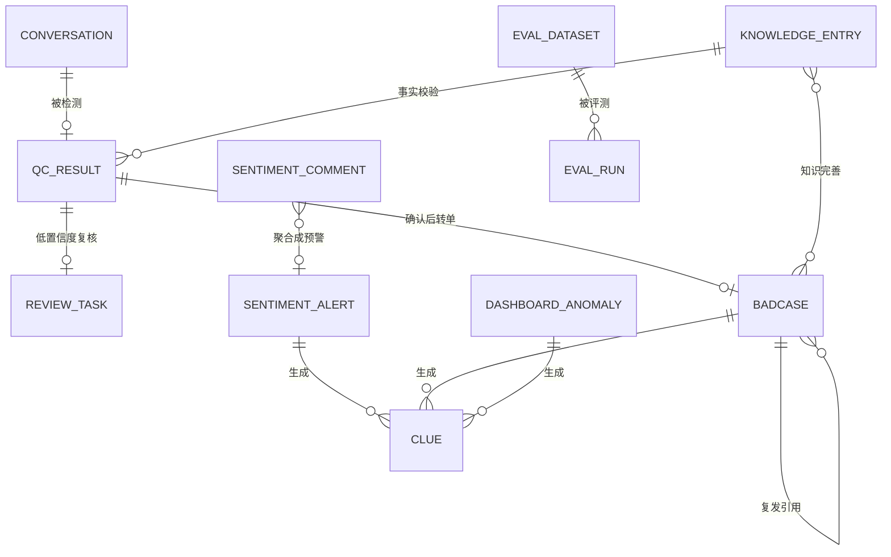
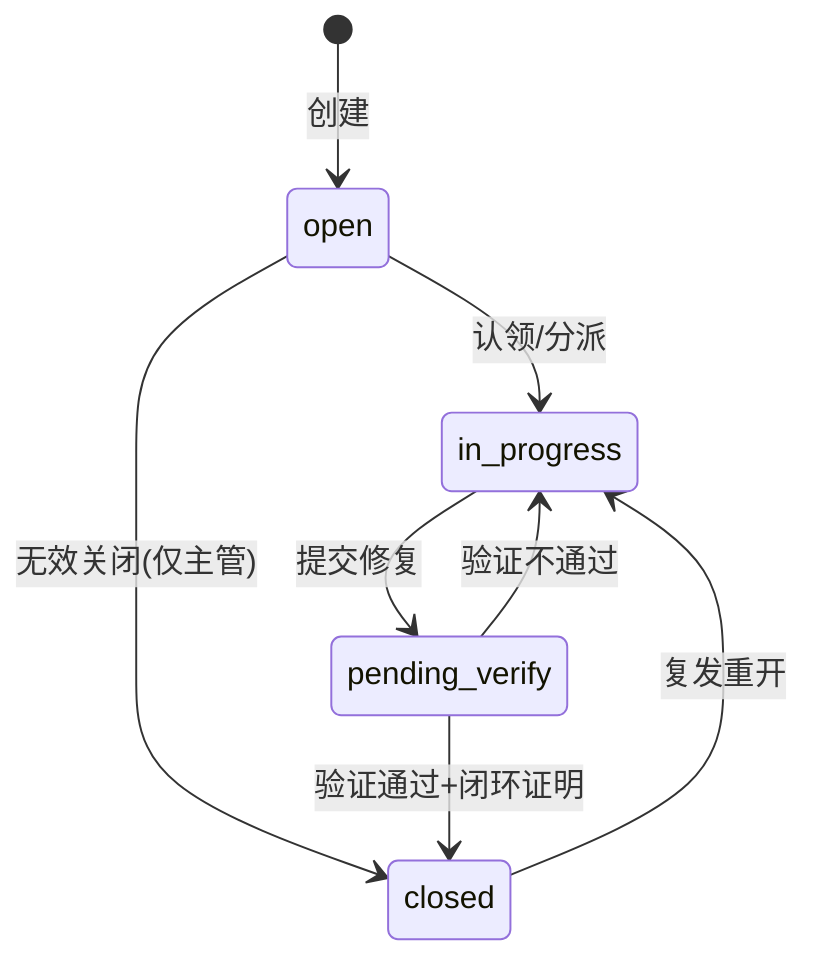
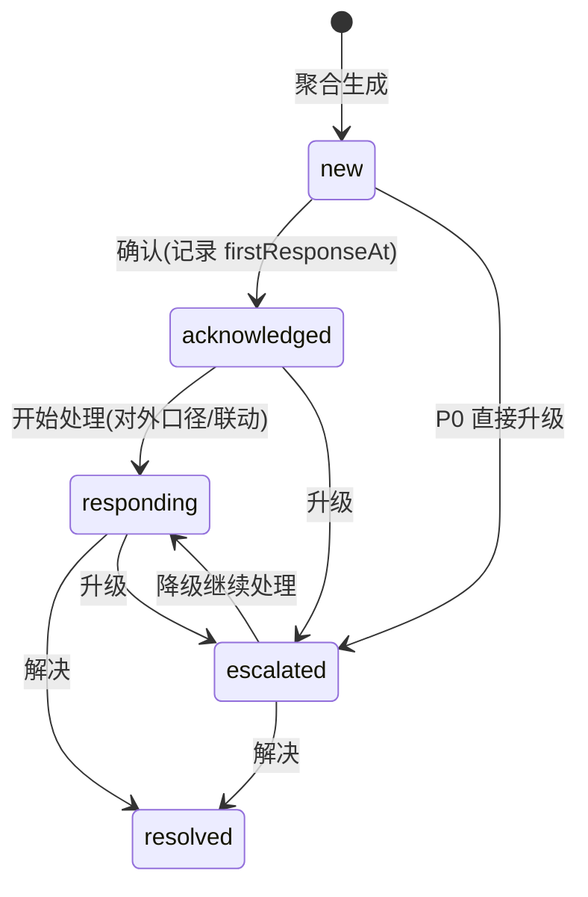
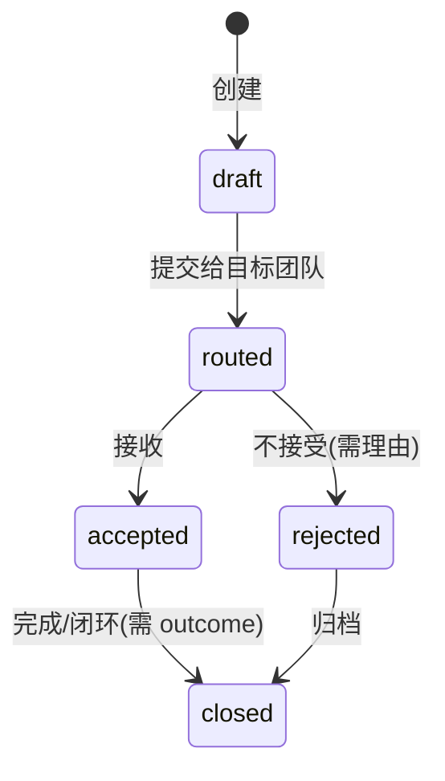

# 004 · 数据模型规格

| 项 | 内容 |
|---|---|
| 版本 | v0.1.0 |
| 状态 | 冻结（MVP 基线；变更需走 Major 变更流程） |
| 下游 | `005-api-contract.md`、`contracts/openapi.yaml`、`apps/api` 实现、`data/` 数据集 |

## 1. 建模原则

1. **一切可追溯**：运行时实体都带 `id`、`createdAt`、状态变更 `timeline`。
2. **原始数据与运行态数据分离**：`data/` 下是版本化评测/种子原始数据（只读、入库）；运行态由 API 从原始数据派生并持久化（可重置）。
3. **状态机显式**：状态只允许规格中声明的转移；非法转移返回 409。
4. **时间统一 ISO 8601 + 东八区偏移**（如 `2026-11-03T10:12:00+08:00`），排序按解析后的绝对时间。
5. **ID 人类可读**：`前缀-序号`，演示时可口头引用。

## 2. 实体总览



## 3. 实体定义

### 3.1 Conversation（对话）

| 字段 | 类型 | 必填 | 说明 |
|---|---|---|---|
| `id` | string | ✅ | `conv-1001` 起 |
| `channel` | `online` \| `ticket` \| `phone` | ✅ | 在线 / 工单 / 电话转写 |
| `product` | string | ✅ | 所属产品，如 `星海远征` |
| `agent` | `{ id, name }` | ✅ | 坐席 |
| `customer` | `{ id, name }` | ✅ | 客户（已脱敏） |
| `startedAt` | ISO string | ✅ | 会话开始时间 |
| `durationSec` | number | ✅ | 会话时长（秒） |
| `messages` | Message[] | ✅ | 见 3.2，至少 4 条 |
| `importedAt` | ISO string | ✅ | 导入时间 |
| `batchId` | string | ✅ | 导入批次 |

### 3.2 Message（消息，内嵌）

| 字段 | 类型 | 说明 |
|---|---|---|
| `seq` | number | 从 1 递增，唯一 |
| `role` | `customer` \| `agent` \| `system` | 说话方 |
| `text` | string | 已脱敏文本 |
| `atSec` | number | 相对会话开始的秒数，用于响应时长计算 |
| `gapSec` | number | 相对上一条消息的间隔（派生，读接口可返回） |

### 3.3 QcResult（质检结果）

| 字段 | 类型 | 说明 |
|---|---|---|
| `id` | string | `qcr-1001` |
| `conversationId` | string | 1:1 |
| `score` | number 0-100 | 100 - 标签权重扣分，下限 0 |
| `verdict` | `pass` \| `violation` | AI 结论（不含"待复核"，用 needsReview 表达） |
| `tags` | QcTag[] | 命中标签，pass 时为空数组 |
| `summary` | string | 一句话摘要（模板生成） |
| `emotion` | `calm` \| `anxious` \| `angry` | 客户情绪 |
| `confidence` | number 0-1 | 整体置信度；保留 2 位小数 |
| `needsReview` | boolean | `confidence < 0.75` |
| `modelVersion` | string | 如 `rule-engine-v0.3.0` |
| `analyzedAt` | ISO string | 检测时间 |
| `latestReviewId` | string \| null | 最近一次复核任务 |

### 3.4 QcTag（标签，内嵌）

| 字段 | 类型 | 说明 |
|---|---|---|
| `code` | 枚举 | `attitude` 服务态度 / `forbidden` 违规话术 / `off_topic` 答非所问 / `wrong_knowledge` 知识错误 / `timeout` 响应超时 / `escalation` 情绪升级 |
| `name` | string | 中文名 |
| `severity` | `low` \| `medium` \| `high` | 严重级别 |
| `confidence` | number 0-1 | 该标签置信度 |
| `evidence` | Evidence[] | 证据 |
| `ruleId` | string | 命中规则，如 `ATT-03` |
| `knowledge` | KnowledgeRef \| null | 知识错误时引用的知识条目、事实与标准值（009）；未覆盖时为 null |

`Evidence`：`{ seq: number, quote: string, note?: string }`。

`KnowledgeRef`：`{ entryId, code, title, factKey, factLabel, expected, actual, ruleId }`。`wrong_knowledge` 标签据此展示「标准口径 vs 坐席陈述」。

### 3.5 ReviewTask（人工复核）

| 字段 | 类型 | 说明 |
|---|---|---|
| `id` | string | `rvw-1001` |
| `qcResultId` | string | 关联质检结果 |
| `conversationId` | string | 冗余，便于跳转 |
| `status` | `pending` \| `done` | 初始 pending |
| `assignee` | string | 复核人（角色模拟） |
| `decision` | `confirm` \| `overturn` \| `amend` \| null | 确认 / 改判 / 修正标签 |
| `finalVerdict` | `pass` \| `violation` \| null | 复核后结论（记账口径） |
| `finalTags` | string[] | 复核后标签 |
| `note` | string | 复核备注（申诉也记这里） |
| `createdAt` / `reviewedAt` | ISO string / null | 时间戳 |

### 3.6 Badcase（badcase 闭环单）

| 字段 | 类型 | 说明 |
|---|---|---|
| `id` | string | `bc-0001` |
| `code` | string | 展示码 `BC-2026-0001` |
| `conversationId` / `qcResultId` | string | 来源 |
| `title` | string | 问题标题 |
| `category` | `knowledge` \| `script` \| `process` \| `system` | 归因：知识缺失/话术/流程/系统 |
| `rootCause` | string | 根因描述（必填，关闭前不得为空） |
| `owner` | string | 责任人 |
| `creator` | string | 创建人 |
| `severity` | `low` \| `medium` \| `high` | 由来源标签最高级别决定 |
| `slaHours` | number | 24 / 48 / 72 |
| `dueAt` | ISO string | 创建时间 + SLA |
| `status` | `open` \| `in_progress` \| `pending_verify` \| `closed` | 见状态机 |
| `recurrence` | boolean | 是否复发 |
| `recurrenceOf` | string \| null | 复发的历史 badcase id |
| `evidence` | Evidence[] | 证据快照 |
| `closedAt` | ISO string \| null | 闭环时间 |
| `proof` | string \| null | 闭环证明（知识库/培训/流程变更说明） |
| `timeline` | BadcaseAction[] | 操作时间线 |
| `createdAt` / `updatedAt` | ISO string | 时间戳 |

`BadcaseAction`：`{ at, by, type: created \| assigned \| progressed \| verified \| closed \| reopened \| commented, note, from, to }`。

### 3.7 SentimentComment（舆情评论 / 分析后）

| 字段 | 类型 | 说明 |
|---|---|---|
| `id` | string | `cmt-0001` |
| `source` | `steam` \| `taptap` \| `googleplay` \| `community` \| `ticket` | 来源 |
| `brand` | string | 品牌/产品 |
| `author` | string | 昵称（脱敏） |
| `text` | string | 评论正文 |
| `publishedAt` | ISO string | 发布时间 |
| `sentiment` | `positive` \| `neutral` \| `negative` | AI 情感 |
| `sentimentScore` | number -1..1 | 情感强度 |
| `topics` | string[] | 主题，取值见 4.3 |
| `primaryTopic` | string | 主主题 |
| `severity` | `p0` \| `p1` \| `p2` \| `none` | 单条评论的预警级别判定 |
| `confidence` | number 0-1 | 判定置信度 |
| `needsReview` | boolean | 低置信度转人工 |
| `alertId` | string \| null | 所属预警 |
| `engineRules` | string[] | 命中的规则 ID |

### 3.8 SentimentAlert（舆情预警）

| 字段 | 类型 | 说明 |
|---|---|---|
| `id` | string | `alt-0001` |
| `level` | `P0` \| `P1` \| `P2` | 分级 |
| `topic` | string | 聚合主题 |
| `title` | string | 如「外挂 · 10-30 集中负面」 |
| `summary` | string | AI 摘要（模板生成，含条数/来源/情绪分布） |
| `windowStart` / `windowEnd` | ISO string | 聚合窗口（按日） |
| `triggerRules` | `{ ruleId, description }[]` | 触发规则 |
| `commentIds` | string[] | 关联评论 |
| `status` | `new` \| `acknowledged` \| `responding` \| `escalated` \| `resolved` | 见状态机 |
| `owner` | string | 责任人（按主题路由） |
| `slaMinutes` | number | P0=30 / P1=120 / P2=1440 |
| `slaDueAt` | ISO string | 创建 + SLA |
| `firstResponseAt` | ISO string \| null | 首次响应（确认即算） |
| `resolvedAt` | ISO string \| null | 解决 |
| `timeline` | AlertAction[] | 操作时间线 |
| `linkedClueIds` | string[] | 关联线索 |
| `createdAt` | ISO string | 创建时间 |

`AlertAction`：`{ at, by, type: created \| acknowledged \| responded \| escalated \| resolved \| commented, note, from, to }`。

### 3.9 Clue（线索）

| 字段 | 类型 | 说明 |
|---|---|---|
| `id` | string | `clue-0001` |
| `title` | string | 线索标题 |
| `description` | string | 背景与建议动作 |
| `sourceType` | `qc` \| `sentiment` \| `dashboard` \| `agent` | 来源类型 |
| `sourceRef` | `{ type, id, label }` | 来源引用（可点击回跳） |
| `target` | `product` \| `brand` \| `market` \| `cs` | 产研 / 品牌 / 市场 / 客服 |
| `priority` | `high` \| `medium` \| `low` | 优先级 |
| `status` | `draft` \| `routed` \| `accepted` \| `rejected` \| `closed` | 见状态机 |
| `owner` | string | 接收方负责人 |
| `createdBy` | string | 创建人 |
| `evidence` | string[] | 证据快照（引用原文/指标） |
| `outcome` | string \| null | 处理结果（闭环/拒绝原因） |
| `timeline` | ClueAction[] | 操作时间线 |
| `createdAt` / `updatedAt` / `closedAt` | ISO | 时间戳 |

### 3.10 EvalRun（评测记录）

| 字段 | 类型 | 说明 |
|---|---|---|
| `id` | string | `eval-0001` |
| `dataset` | `qc` \| `sentiment` | 评测域 |
| `datasetId` / `datasetVersion` | string | 数据集标识 |
| `runAt` | ISO string | 运行时间 |
| `durationMs` | number | 耗时 |
| `modelVersion` | string | 引擎版本 |
| `metrics` | Record<string, number> | 指标值（键见 007） |
| `confusion` | object | 混淆矩阵（见 007） |
| `mismatches` | `{ itemId, expected, predicted, reason }[]` | 错例（最多 20 条） |
| `thresholdsMet` | Record<string, boolean> | 各指标是否达标 |
| `summary` | string | 一句话结论（达标/未达标） |

### 3.11 MetricSnapshot（日指标快照）

演示用，用于趋势图；字段：`date`、`qcCoverage`、`qcAccuracy`、`qcReviewRatio`、`badcaseCloseRate`、`recurrenceRate`、`p0ResponseMin`、`p1ResponseMin`、`alertPrecision`、`sentimentAccuracy`、`clueCloseRate`、`clueConversion`、`csat`、`firstResponseSec`、`transferRate`。共 14 天，种子时生成并持久化。

### 3.12 DashboardAnomaly（异常，派生）

不是独立存储实体，由看板聚合计算得出：`{ id, metric, metricLabel, current, target, deviation, severity, drillType: "qc"|"sentiment"|"badcase"|"clue", drillFilter, owner, suggestion }`。

### 3.13 KnowledgeEntry（知识条目）

| 字段 | 类型 | 说明 |
|---|---|---|
| `id` | string | `kb-0001` |
| `code` | string | 展示码 `KB-1001` |
| `title` | string | 条目标题 |
| `category` | `refund` \| `recharge` \| `activity` \| `version` \| `account` \| `other` | 分类（§4.8） |
| `status` | `draft` \| `published` \| `offline` | 当前版本状态（§4.9） |
| `version` | number | 当前版本号 |
| `content` | string | 标准口径正文 |
| `facts` | KnowledgeFact[] | 结构化事实与识别规则 |
| `keywords` | string[] | 检索关键词 |
| `owner` | string | 责任人，默认顾清 |
| `source` | `official` \| `qc_badcase` \| `manual` | 来源（§4.10） |
| `sourceRef` | `{ type: conversation\|badcase\|manual, id, label } \| null` | 来源引用 |
| `linkedBadcaseIds` | string[] | 关联 badcase |
| `revisions` | KnowledgeRevision[] | 版本历史（含当前版本快照） |
| `createdAt` / `updatedAt` | ISO string | 时间戳 |
| `publishedAt` | ISO string \| null | 最近一次发布时间 |

`KnowledgeFact`：`{ key, label, expected, compare: number|duration_minutes|date|text, expectedNumber?, expectedMinutes?, expectedMonth?, expectedDay?, unit?, claimPatterns: string[], violationPatterns: string[], note? }`。

`KnowledgeRevision`：`{ version, status, content, facts, note, by, at }`；修订人 `by` 默认顾清。

> 只有 `published` 条目参与质检；`draft` / `offline` 不参与。修订后条目回到 draft，旧版本保留在 `revisions`。详见 `009-knowledge-base.md`。

## 4. 枚举与字典

### 4.1 质检标签与扣分权重

| code | 名称 | 严重级别 | 扣分 | 识别信号（规格级） |
|---|---|---|---|---|
| `attitude` | 服务态度 | high | 25 | 辱骂、指责、嘲讽、反问羞辱、驱赶 |
| `forbidden` | 违规话术 | high | 30 | 索要好评、私下交易、站外引流、泄露隐私、绝对化承诺 |
| `off_topic` | 答非所问 | medium | 15 | 用户问题与坐席回答意图不匹配 |
| `wrong_knowledge` | 知识错误 | high | 25 | 与知识库事实冲突的陈述（费率/时间/规则） |
| `timeout` | 响应超时 | medium | 10 | 坐席回复间隔 > 180 秒 |
| `escalation` | 情绪升级 | medium | 20 | 用户从平静转为愤怒、要求投诉/曝光/退款升级 |

> `escalation` 是对"会话风险"的标记，不计入坐席个人过错统计（界面注明），但计入质检结果。

### 4.2 归因类别

| code | 名称 | 典型闭环动作 |
|---|---|---|
| `knowledge` | 知识缺失 | 知识库新增/修订条目，标注复测 |
| `script` | 话术问题 | 话术模板更新 + 培训 |
| `process` | 流程问题 | 流程/SOP 修订 |
| `system` | 系统问题 | 产品缺陷或工具问题转产研 |

### 4.3 舆情主题

`版本`、`充值`、`外挂`、`客服`、`活动`、`Bug`、`其他`。

### 4.4 角色（模拟）

`qc`（质检/培训）、`lead`（客服主管）、`agent`（坐席）、`brand`（品牌/市场）、`product`（产研）、`algo`（算法/研发）。MVP 只用于界面与责任人默认值。

### 4.5 责任人路由（种子数据）

| 主题/归因 | 默认责任人 |
|---|---|
| 质检复核 | 沈言（质检组长） |
| badcase `knowledge` | 顾清（知识运营） |
| badcase `script` | 唐沐（培训） |
| badcase `process` | 陆川（客服主管） |
| badcase `system` | 周野（产研） |
| 舆情 `外挂` / `充值` | 江岚（品牌） |
| 舆情 `版本` / `Bug` | 周野（产研） |
| 舆情 `客服` / `活动` / `其他` | 陆川（客服主管） |
| 线索接收 `product` | 周野 |
| 线索接收 `brand` | 江岚 |
| 线索接收 `market` | 程雨 |
| 线索接收 `cs` | 陆川 |

> 舆情预警 `owner` 口径：P0 → 江岚（品牌，主责；陆川/周野为通知范围）；P1/P2 → 按主题行路由（v0.1.1 澄清）。

### 4.6 知识条目分类

| code | 名称 | 典型事实 |
|---|---|---|
| `refund` | 退款 | 手续费、受理条件、到账时效 |
| `recharge` | 充值 | 到账时效、返利比例、订单查询 |
| `activity` | 活动 | 时间、次数、奖励、结束口径 |
| `version` | 版本 | 上线时间、版本内容、维护窗口 |
| `account` | 账号 | 封禁、申诉、找回、实名 |
| `other` | 其他 | 不属于以上分类的政策口径 |

### 4.7 知识条目状态

`draft`（草稿，不参与质检）→ `published`（已发布，参与质检）→ `offline`（已下线）；`published --revise--> draft`（新版本待发布，旧版本留档）。

### 4.8 知识条目来源

| code | 名称 | 说明 |
|---|---|---|
| `official` | 官方口径 | 来自公告/规则文档 |
| `qc_badcase` | 质检驱动 | 由质检知识错误或 badcase 生成 |
| `manual` | 人工新增 | 知识运营手工创建 |

## 5. 状态机

### 5.1 Badcase



规则：`pending_verify → closed` 必须提供 `proof`；`closed` 后 7 天内同标签同根因再次出现则 `recurrence=true` 并允许重开；每次状态变更写 timeline。

### 5.2 SentimentAlert



规则：`firstResponseAt` 在 `new → acknowledged` 或 `new → escalated` 时写入，用于计算响应时长；超 SLA 未确认的预警在列表与看板标红。

### 5.3 Clue



### 5.4 ReviewTask

`pending → done`，`decision` 必填（confirm/overturn/amend）。

## 6. 指标派生

所有指标计算口径见 `007-evaluation-spec.md`；运行时看板指标由后端 `metrics` 服务统一计算，前端不做二次计算。`MetricSnapshot` 用于趋势展示，当前值优先由实时状态计算。

## 7. 原始数据集格式（`data/`）

> 只读输入，版本化提交到仓库；由 `data/scripts/generate.mjs` 生成，人工校订。

### 7.1 目录

```
data/
├── manifest.json
├── README.md
├── qc/
│   └── dataset.json
├── sentiment/
│   └── dataset.json
└── scripts/
    └── generate.mjs
```

### 7.2 `data/manifest.json`

```json
{
  "version": "0.1.0",
  "generatedAt": "2026-11-03T10:00:00+08:00",
  "description": "QCC MVP 合成评测/种子数据集",
  "datasets": {
    "qc": { "datasetId": "qc-eval-v0.1", "version": "0.1.0", "file": "qc/dataset.json", "itemCount": 60 },
    "sentiment": { "datasetId": "sentiment-eval-v0.1", "version": "0.1.0", "file": "sentiment/dataset.json", "itemCount": 120 }
  }
}
```

### 7.3 `data/qc/dataset.json`

```json
{
  "datasetId": "qc-eval-v0.1",
  "version": "0.1.0",
  "description": "客服质检评测集：覆盖 6 类标签、正常样本与低置信度边界样本",
  "items": [
    {
      "id": "qc-0001",
      "channel": "online",
      "product": "星海远征",
      "agent": { "id": "A-1003", "name": "林晓" },
      "customer": { "id": "C-7781", "name": "用户8821" },
      "startedAt": "2026-10-27T10:12:00+08:00",
      "durationSec": 486,
      "messages": [
        { "seq": 1, "role": "customer", "text": "昨天充的648没到账，订单号138****2210，帮我查一下", "atSec": 0 },
        { "seq": 2, "role": "agent", "text": "好的，我帮您查一下订单，请稍等", "atSec": 33 },
        { "seq": 3, "role": "customer", "text": "都等十分钟了，还没好？", "atSec": 630 },
        { "seq": 4, "role": "agent", "text": "系统显示已到账，您自己不会看吗？", "atSec": 645 }
      ],
      "labels": {
        "verdict": "violation",
        "tags": ["attitude"],
        "primaryTag": "attitude",
        "note": "坐席使用嘲讽反问，服务态度违规；等待超时仅构成辅助信号"
      }
    }
  ]
}
```

**标注约束**

- `labels.verdict`：`pass` 或 `violation`；`violation` 时 `tags` 至少 1 个，`pass` 时为空数组。
- `labels.primaryTag`：唯一主标签（用于主指标），无违规为 `null`。
- 对话条数 4-14 条，`atSec` 单调递增；应答间隔由 `atSec` 差值计算。
- 标签覆盖配额（60 条）：`attitude` ≥ 8、`forbidden` ≥ 8、`off_topic` ≥ 7、`wrong_knowledge` ≥ 7、`timeout` ≥ 6、`escalation` ≥ 6、pass ≥ 20；允许多标签共现。
- 低置信度边界样本 ≥ 10 条（信号隐晦，人工标注仍给出明确结论）。

### 7.4 `data/sentiment/dataset.json`

```json
{
  "datasetId": "sentiment-eval-v0.1",
  "version": "0.1.0",
  "description": "舆情评测集：按 主题×日期 形成 12-16 个聚合簇，覆盖 P0/P1/P2/正常/噪声",
  "items": [
    {
      "id": "cm-0001",
      "source": "steam",
      "brand": "星海远征",
      "author": "player_lee",
      "publishedAt": "2026-10-30T21:14:00+08:00",
      "text": "新版本一更新就回档，氪的金全没了，官方再不管我们就去12315投诉",
      "language": "zh",
      "labels": {
        "sentiment": "negative",
        "topics": ["版本", "充值"],
        "primaryTopic": "版本",
        "expectedLevel": "P0",
        "noise": false,
        "note": "回档+充值损失+维权信号，P0"
      }
    }
  ]
}
```

**标注约束**

- `sentiment`：`positive` / `neutral` / `negative`。
- `topics`：1-3 个，取自 4.3 的主题字典；`primaryTopic` 必填。
- `expectedLevel`：`P0` / `P1` / `P2` / `none`，由 007 的分级规则判定；`noise=true` 时为 `none`。
- 聚合关系由 `primaryTopic + publishedAt 日期` 决定，数据需成簇（每簇 4-12 条），并覆盖：≥ 2 个 P0 簇、≥ 3 个 P1 簇、≥ 3 个 P2 簇、≥ 3 个 none 簇。
- 120 条中负面 ≥ 60 条，噪声（广告/无关/纯情绪灌水）≥ 8 条。
- 来源五类齐全，日期分布在 2026-10-20 至 2026-11-02。

### 7.5 金标读取口径（v0.1.1 澄清，Lead 裁决）

数据生成时允许在冻结字段之外附加**非必填扩展字段**，用于支撑评测、复核与页面展示；但读取方必须坚持以下主口径，不得把扩展字段当必填：

- QC 主口径：`labels.verdict`、`labels.tags`（标签 code 字符串数组）、`labels.primaryTag`、`labels.note`。可选扩展：`tagEvidence:[{code,evidenceSeq,quote}]`、`confidence`、`needsReview`、`summary`、`emotion`。
- 舆情主口径：`labels.sentiment`、`labels.topics`、`labels.primaryTopic`、`labels.expectedLevel`、`labels.noise`、`labels.note`。可选扩展：`severity`（=`expectedLevel` 小写）、`confidence`、`needsReview`、`sentimentScore`。
- `data/manifest.json` 同时保留 `version` 与扩展字段 `datasetVersion`；后端以 `version` 判断数据集版本，展示层可用 `datasetVersion`。
- 评测聚合簇仍按 `primaryTopic + 日期` 划分；`expectedLevel` 为单条金标，聚合升级结果由评测回放按 007 §5 计算。

## 8. 存储与一致性

- 运行态存储：`apps/api/.data/store.json`（单文件、启动加载、写操作后原子落盘：临时文件 + rename）。
- 初始化：首次启动读取 `data/` 数据集 → 运行引擎 → 生成运行态实体 → 持久化；`POST /api/admin/reset` 删除运行态并重建，保证演示可复现。
- 并发：单进程内存 + 串行写队列，MVP 不处理多实例。
- 种子数据的"当前时间"以服务启动时间为基准做偏移（`DEMO_NOW` 可配），保证 SLA/趋势始终贴近"最近 14 天"。

## 9. 变更记录

| 版本 | 日期 | 变更 | 作者 |
|---|---|---|---|
| v0.1.0 | 2026-11-03 | 初版：运行态实体、状态机、原始数据集格式冻结 | Lead |
| v0.1.1 | 2026-11-03 | §7.5 澄清金标主字段与可选扩展字段、manifest 双版本字段（Lead 裁决） | Lead |
