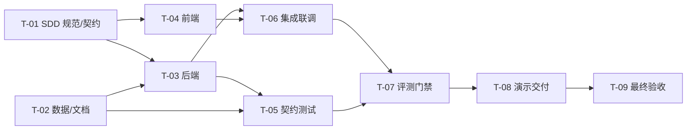

# SDD-008 任务分解与实施计划

> 版本：v0.1.0 ｜ 状态：执行中 ｜ 更新：2026-11-03
> 上游：`002-spec.md`、`003-architecture.md` ｜ 看板：Team task board（task-1..task-5）

---

## 1. 计划概览

MVP 目标：**一个可本地启动、可完整演示、可跑评测的 AI 客服质量运营工作台**，覆盖 PRD 三模块与评测中心。

| 阶段 | 内容 | 产出 | 门禁 |
|---|---|---|---|
| P0 规范 | SDD 文档集、契约冻结、数据字典 | specs/ 全套 + openapi + fixtures | Gate-0 规范评审通过 |
| P1 数据 | 合成数据集 + 业务模板 | data/、docs/ | 数据校验 `--check` 通过 |
| P2 后端 | 27 端点 + 规则引擎 + 种子 + 评测 | apps/api | 冒烟全 200、build 0 error |
| P3 前端 | 8 页面 + 设计系统 + 联调 | apps/web | typecheck/build 通过、页面可走通 |
| P4 验证 | 契约测试、验收流程、评测门禁 | tests/、报告 | Gate-4/5 通过 |
| P5 交付 | README、演示脚本、截图、提交 | 根文档 + git commit | 演示 10 分钟跑通 |

---

## 2. 任务卡

> 状态：`todo / doing / done / blocked`。每个任务只有一个 owner，写作用域互斥。验收标准（AC）必须可执行。

### T-01 SDD 规范与契约（owner：Lead，状态：doing）
- 范围：`specs/**`（README、000–008、contracts、fixtures、checklists、traceability）
- 交付：文档集自洽、OpenAPI 通过 `npx @redocly/cli lint`（或 `swagger-cli validate`）、fixtures 与 schema 一致
- AC：① 27 端点与 002 FR 可双向追溯；② 无 TBD/待定；③ 评审清单全勾
- 依赖：无

### T-02 数据集与业务文档（owner：data-lab，状态：doing，看板 task-1）
- 范围：`data/**`、`docs/**`
- 交付：qc 60 条、sentiment 120 条、manifest、generate.mjs（含 --check）、5 份 docs
- AC：① `node data/scripts/generate.mjs --check` exit 0；② 标签/簇定额与 004 一致；③ 重复生成字节一致；④ docs 含模板与口径表
- 依赖：无

### T-03 后端 API（owner：backend-dev，状态：doing，看板 task-2）
- 范围：`apps/api/**`
- 交付：27 端点、规则引擎、种子/重置、评测器、脱敏、错误处理
- AC：① `pnpm --filter @qcc/api build` 0 error；② 冒烟 27 端点 200；③ 409/422 各至少 1 例；④ 两次 reset 结果确定；⑤ evaluator qc accuracy ≥0.80、sentiment alertPrecision ≥0.80
- 依赖：T-02（数据）；可先用 schema 开发

### T-04 前端 Web（owner：frontend-dev，状态：doing，看板 task-3）
- 范围：`apps/web/**`
- 交付：设计系统、8 页面、全部交互、错误/空/加载态
- AC：① `pnpm --filter @qcc/web build` 与 typecheck 通过；② 7 个路由直达刷新可用；③ 006 第 8 节清单全勾；④ 联调真实 API 无 mock
- 依赖：T-01（UI 规范/契约）；联调依赖 T-03

### T-05 契约与验收测试（owner：qa，状态：todo，看板 task-4）
- 范围：`tests/**`（不改 apps/、data/）
- 交付：node:test 脚本：health/meta 契约、27 端点状态码、QC 复核流程、badcase 状态机/闭环证明/复发、预警 SOP/SLA、线索状态机、评测门禁、reset 确定性、脱敏断言；`tests/report.md`
- AC：① `pnpm test` 全绿；② 与 002 Given/When/Then 对齐；③ 失败用例含期望/实际
- 依赖：T-03、T-02

### T-06 集成与联调（owner：Lead，状态：todo）
- 范围：根目录、apps 集成配置（不覆盖成员文件）
- 内容：安装/构建/启动、代理、静态托管（如需要）、跨端字段对齐、修复集成缺陷（在各 owner 同意下改小范围）
- AC：`pnpm install && pnpm build && pnpm typecheck` 通过；`pnpm dev` 双端起；页面真实数据
- 依赖：T-03、T-04

### T-07 评测与质量门禁（owner：Lead+qa，状态：todo）
- 内容：运行 qc/sentiment 评测、核对 002 指标目标、记录偏差与解释、更新 `specs/007` 实测值
- AC：生成 `docs/eval-report.md`（指标表 + 门禁结论 + 错例分析 + 局限性）
- 依赖：T-03、T-05

### T-08 演示与交付（owner：Lead，状态：todo）
- 内容：根 `README.md`（定位/架构图/快速开始/端口/演示路径/指标/边界）、`docs/demo-script.md`（10 分钟分镜）、`docs/architecture.md`（或复用 003）、截图（总览/质检详情/badcase/预警/线索/评测）、git commit
- AC：① 新机器按 README 三条命令跑通；② 演示脚本每步有预期画面；③ 截图与当前 UI 一致；④ git 历史干净
- 依赖：T-06

### T-09 项目管理与最终验收（owner：Lead，状态：todo）
- 内容：更新任务看板、检查清单、风险记录、最终汇报
- AC：Gate-5 发布清单全勾；`goal` 完成条件逐条核对
- 依赖：全部

---

## 3. 依赖关系图

---

## 4. 里程碑

| 里程碑 | 时间 | 判定标准 |
|---|---|---|
| M0 规范冻结 | 2026-11-03 | specs v0.1.0 冻结，OpenAPI 校验通过 |
| M1 数据就绪 | 2026-11-03 | `--check` 通过，标签定额达标 |
| M2 后端可跑 | 2026-11-03 | 27 端点冒烟通过，评测跑通 |
| M3 前端可看 | 2026-11-03 | 8 页面构建通过，真实数据联调 |
| M4 验收通过 | 2026-11-03 | `pnpm test` 全绿 + 发布清单 |
| M5 可演示 | 2026-11-03 | README + 演示脚本 + 截图 + commit |

> 本项目为 MVP 冲刺，里程碑压缩在单日；真实项目按 PRD 的 10 周计划排期（见 001-prd.md）。

---

## 5. 工作协议

1. **契约优先**：任何接口字段变更 → 先改 `specs/contracts/openapi.yaml` + `specs/005` + 前端 types，Lead 审批后实施。
2. **写作用域**：Lead = specs/ + 根文档 + 集成；data-lab = data/ + docs/；backend-dev = apps/api/；frontend-dev = apps/web/；qa = tests/。跨域修改必须先沟通。
3. **提交**：由 Lead 在集成后统一 `git add -A && git commit`，成员不自行提交，避免冲突。
4. **报告**：每个任务完成时向 Lead 发「交付物 / 验证命令与输出 / 偏差 / 未决问题」四段式报告。
5. **阻塞**：超过 15 分钟无法推进 → 报告 Lead，不自行扩大范围或改契约。
6. **质量**：不提交 `any`、`@ts-ignore`、注释掉的代码、mock 数据、未使用依赖；不删除他人文件。

---

## 6. 验收清单（Gate-5）

- [ ] `pnpm install` 无 error
- [ ] `pnpm build` 两端成功
- [ ] `pnpm typecheck` 无错误
- [ ] `pnpm test` 全绿
- [ ] 后端 27 端点冒烟通过
- [ ] 前端 8 路由可直达、无 console error
- [ ] 评测 qc 准确率 ≥80%、误报 ≤15%；sentiment 预警准确率 ≥80%
- [ ] reset 后数据确定可复现
- [ ] README/演示脚本/截图/业务模板齐备
- [ ] git commit 完成，工作区干净

---

## 7. 变更记录

| 版本 | 日期 | 变更 | 作者 |
|---|---|---|---|
| v0.1.0 | 2026-11-03 | 首版任务分解（T-01..T-09），对齐 team board task-1..task-5 | Lead |
