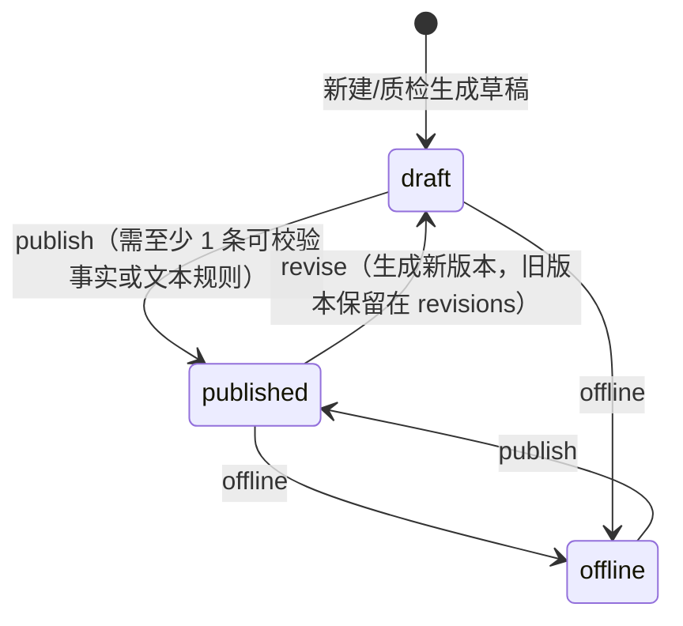

# 009 · 知识库与知识完善闭环规格

| 项 | 内容 |
|---|---|
| 版本 | v0.1.0 |
| 状态 | 新增（QC 主线增强） |
| 上游 | `002-spec.md`（FR-QC-004/007）、`007-evaluation-spec.md`（wrong_knowledge 口径） |
| 下游 | `004-data-model.md`、`005-api-contract.md`、`contracts/openapi.yaml`、`apps/api`、`apps/web`、`data/knowledge/entries.json` |

> 一句话：把「知识库」从质检规则的一句注释，变成**可版本化、可校验、可被质检引用、能被质检结果反向完善**的一等实体。

---

## 1. 目标与非目标

### 1.1 目标

1. **知识即规则**：`wrong_knowledge` 不再依赖写死的正则注释，而是对照已发布知识条目中的结构化事实（费率 / 时效 / 次数 / 日期 / 固定口径）判定。
2. **证据可解释**：每个知识错误标签携带 `knowledge` 引用，说明「标准口径是什么、坐席说成了什么、对应哪个条目」。
3. **知识完善闭环**：质检结果与 badcase 能一键生成知识草稿；草稿修订 → 发布 → 自动复测 → 显示前后差异。
4. **缺口可见**：未被知识库覆盖的知识错误命中、未关联知识条目的知识类 badcase，进入「知识缺口」列表。
5. **版本可追溯**：条目每次修订保留版本、状态、事实快照、修订人、时间与原因。

### 1.2 非目标

- 不做文档解析 / 向量检索 / RAG；MVP 使用结构化事实 + 确定性规则。
- 不做知识审批流（MVP 由知识运营直接发布/下线）。
- 不做多租户、权限与自动对外发布。
- 不替代人工复核：知识命中仍是 AI 初判，低置信度仍走复核。

---

## 2. 角色与场景

| 角色 | 场景 |
|---|---|
| 知识运营（顾清） | 维护标准口径；处理质检缺口；发布后复测 |
| 质检组长（沈言） | 在质检详情查看知识依据；把无法解释的错误转知识完善 |
| 客服主管（陆川） | 在 badcase 详情把知识类问题转知识完善 |
| 坐席（演示） | 不再因「知识库版本过旧」重复答错 |

核心演示路径：

```text
质检发现 wrong_knowledge
  → 详情显示 KB 条目 / 标准值 / 实际值
  → 未覆盖时生成知识草稿（或从 badcase 生成）
  → 顾清补齐事实并发布
  → 自动复测：新建/更新 QcResult，缺口数下降
  → 质检详情出现知识引用，badcase 可引用条目编号闭环
```

---

## 3. 数据模型（详见 004 §3.10）

### 3.1 KnowledgeEntry

| 字段 | 类型 | 说明 |
|---|---|---|
| `id` | string | `kb-0001` |
| `code` | string | 展示码 `KB-1001` |
| `title` | string | 条目标题 |
| `category` | `refund` \| `recharge` \| `activity` \| `version` \| `account` \| `other` | 分类 |
| `status` | `draft` \| `published` \| `offline` | 当前版本状态 |
| `version` | number | 当前版本号（从 1 起） |
| `content` | string | 标准口径正文 |
| `facts` | KnowledgeFact[] | 结构化事实与识别规则 |
| `keywords` | string[] | 检索关键词 |
| `owner` | string | 责任人（默认顾清） |
| `source` | `official` \| `qc_badcase` \| `manual` | 来源 |
| `sourceRef` | `{ type, id, label } \| null` | 来源会话 / badcase |
| `linkedBadcaseIds` | string[] | 关联 badcase |
| `revisions` | KnowledgeRevision[] | 版本历史（含当前版本） |
| `createdAt` / `updatedAt` / `publishedAt` | ISO string / null | 时间戳 |

### 3.2 KnowledgeFact

| 字段 | 类型 | 说明 |
|---|---|---|
| `key` | string | 事实键，条目内唯一 |
| `label` | string | 事实名称，如「退款手续费」 |
| `expected` | string | 标准值展示文本 |
| `compare` | `number` \| `duration_minutes` \| `date` \| `text` | 比对方式 |
| `expectedNumber` / `expectedMinutes` / `expectedMonth` / `expectedDay` | number \| null | 结构化期望值 |
| `unit` | string \| null | 展示单位 |
| `claimPatterns` | string[] | 从坐席原话提取陈述的正则（第 1 组为数值；duration 第 2 组为单位；date 第 1/2 组为月/日） |
| `violationPatterns` | string[] | 直接判定违规的文本正则（用于无法结构化的口径） |
| `note` | string \| null | 口径说明 |

**折算规则（确定性）**：`小时=60`、`分钟=1`、`天/自然日=1440`、`工作日=480`（8 小时）。

### 3.3 KnowledgeRef（挂在 QcTag 上）

| 字段 | 说明 |
|---|---|
| `entryId` / `code` / `title` | 命中的条目 |
| `factKey` / `factLabel` | 命中的事实 |
| `expected` / `actual` | 标准值 / 坐席陈述值 |
| `ruleId` | 关联的质检规则 ID（KB 命中为 `R-QC-KNW-KB`） |

---

## 4. 状态机



规则：

- `published` 的条目参与质检；`draft` / `offline` 不参与。
- 修订后当前条目回到 `draft`，旧版本仍在 `revisions`，发布前该条目暂时不参与质检。
- 发布 / 下线后自动触发一次复测（见 §6）。
- 非法状态操作返回 409（如对已发布条目再次 publish、对草稿 offline 允许、对已下线条目 offline 返回 409）。

---

## 5. 质检联动规则

### 5.1 KB 驱动的知识错误检测（R-QC-KNW-KB）

对每条已发布条目、每个事实、每条坐席消息：

1. 按 `claimPatterns` 提取陈述（number / duration / date）；与期望值不一致 → 命中 `wrong_knowledge`。
2. 按 `violationPatterns` 命中 → 命中 `wrong_knowledge`（text 类）。
3. 证据 `quote` 取命中原文子串（≤60 字），`seq` 指向消息；标签附 `knowledge` 引用。
4. 置信度：数值/日期冲突 0.90；文本口径冲突 0.86。

### 5.2 旧规则与新知识库的优先级

- 保留 `R-QC-KNW-01..10` 作为**兜底规则库**，用于知识库尚未覆盖的说法。
- 若某条兜底命中能被已发布事实覆盖（`claimPatterns` / `violationPatterns` 命中）：
  - 知识库判定冲突 → 保留标签并附加 `knowledge` 引用；
  - 知识库判定不冲突 → **丢弃该标签**（知识库为准，避免旧规则误报）。
- 若无法被任何已发布事实覆盖 → 保留标签，`knowledge = null`，计入知识缺口。

> 这条优先级是「知识完善能改善质检」的关键：修订/发布知识条目会真实改变检测结果。

### 5.3 复核与人工结论

- 已人工复核（done）的会话在复测中不被覆盖，保留复核后的标签与判定。
- 复测只更新未复核会话的 QcResult；同步维护 pending 复核任务（不再需要的移除，新需要的补建）。

---

## 6. 复测（Recheck）

触发：条目 publish / offline 成功后自动执行；也可手动 `POST /api/knowledge/{id}/recheck`。

| 步骤 | 行为 |
|---|---|
| 1 | 取当前全部 `published` 条目作为知识上下文 |
| 2 | 对全部未完成复核的会话重新执行 `analyzeQc` |
| 3 | 仅当标签集合 / 判定 / 知识引用发生变化时更新 QcResult（`analyzedAt = 当前业务时间`） |
| 4 | 维护复核队列：`needsReview` 的结果有 pending 任务；不再需要的 pending 任务删除 |
| 5 | 返回 `rechecked`、`changed`、`before/after` 统计与最多 20 条变化明细 |

`before/after` 统计字段：`knowledgeTags`、`linkedKnowledgeTags`、`unlinkedKnowledgeTags`、`gaps`。

---

## 7. 知识缺口（Gaps）

缺口来源：

1. **未关联的质检命中**：`wrong_knowledge` 标签 `knowledge = null`，按 `ruleId` 分组合并；附样例会话、证据与出现次数。
2. **未关联的知识类 badcase**：`category = knowledge` 且未被任何条目 `sourceRef` / `linkedBadcaseIds` 引用。

每条缺口包含：`id`、`type`、`ruleId/badcaseId`、`title`、`count`、`category`、`owner`、`sample`（会话/证据）。

---

## 8. API（详见 005 §3.13 / openapi）

| API ID | 方法 | 路径 | 说明 |
|---|---|---|---|
| API-KB-01 | GET | `/api/knowledge` | 列表（q/status/category/source/badcaseId/分页） |
| API-KB-02 | GET | `/api/knowledge/stats` | 条目、命中、覆盖、缺口统计 |
| API-KB-03 | GET | `/api/knowledge/gaps` | 知识缺口列表 |
| API-KB-04 | GET | `/api/knowledge/{id}` | 详情（含关联会话、badcase、版本） |
| API-KB-05 | POST | `/api/knowledge` | 新建草稿 |
| API-KB-06 | POST | `/api/knowledge/{id}/revisions` | 新建修订（回到 draft） |
| API-KB-07 | POST | `/api/knowledge/{id}/publish` | 发布（自动复测） |
| API-KB-08 | POST | `/api/knowledge/{id}/offline` | 下线（自动复测） |
| API-KB-09 | POST | `/api/knowledge/{id}/recheck` | 手动复测 |
| API-KB-10 | POST | `/api/knowledge/suggestions` | 从会话 / badcase 生成草稿（幂等） |

---

## 9. UI（详见 006 §5.10 / §5.11）

- `/knowledge`：统计条 + 知识缺口面板 + 筛选 + 表格（编号/标题/分类/版本/状态/知识错误命中/关联 badcase/更新时间）。
- `/knowledge/:id`：标准口径、事实表、知识错误证据、关联 badcase、版本历史；操作：编辑修订 / 发布 / 下线 / 复测。
- `/qc/:id`：`wrong_knowledge` 标签显示知识引用（标准值 vs 实际值）；未覆盖时提供「生成知识完善草稿」。
- `/badcases/:id`：知识类 badcase 显示关联条目；无关联时提供「生成知识完善草稿」。

---

## 10. 指标口径（MET-KB-*）

| ID | 指标 | 公式 | 目标 |
|---|---|---|---|
| MET-KB-LINK | 知识错误关联率 | 带 `knowledge` 引用的知识错误标签 / 全部知识错误标签 | ≥ 90% |
| MET-KB-GAP | 知识缺口数 | 未关联规则组 + 未关联知识类 badcase | 趋势下降 |
| MET-KB-PUB | 知识发布率 | published / 全部条目 | ≥ 70%（演示 7/9） |
| MET-KB-CLOSE | 知识完善闭环率 | 有发布条目关联的知识类 badcase / 知识类 badcase | ≥ 70% |
| MET-KB-RECHECK | 复测生效数 | 发布/下线后标签或引用发生变化的会话数 | 展示用 |

---

## 11. 验收场景

```gherkin
Scenario: 质检知识错误带知识依据
  Given 已发布 KB-1001（退款手续费 0%）
  And   某会话坐席称「退款手续费是 20%」
  When  查询该会话质检详情
  Then  wrong_knowledge 标签带有 knowledge.expected = "0%（不收取手续费）"
  And   knowledge.actual 包含 "20%"

Scenario: 未覆盖的知识错误进入缺口
  Given 某会话命中充值返利比例错误，但无已发布事实覆盖
  When  查询知识缺口
  Then  该命中以 ruleId 分组出现在 gaps 中
  And   可直接从该会话生成知识草稿

Scenario: 发布后复测
  Given 一条知识草稿补齐了事实与识别规则
  When  调用 publish
  Then  条目状态变为 published
  And   返回 recheck.changed 与 before/after 统计
  And   未复核会话的 QcResult 可被更新，复核结论不被覆盖

Scenario: 旧规则被知识库纠正
  Given 旧兜底规则命中某说法，而已发布事实判定该说法合规
  When  执行复测
  Then  该 wrong_knowledge 标签被移除
  And   结果摘要与分数同步更新
```

---

## 12. 变更记录

| 版本 | 日期 | 变更 |
|---|---|---|
| v0.1.0 | 2026-11-03 | 首版：知识条目、事实校验、质检联动、缺口、复测、UI 与指标 |
